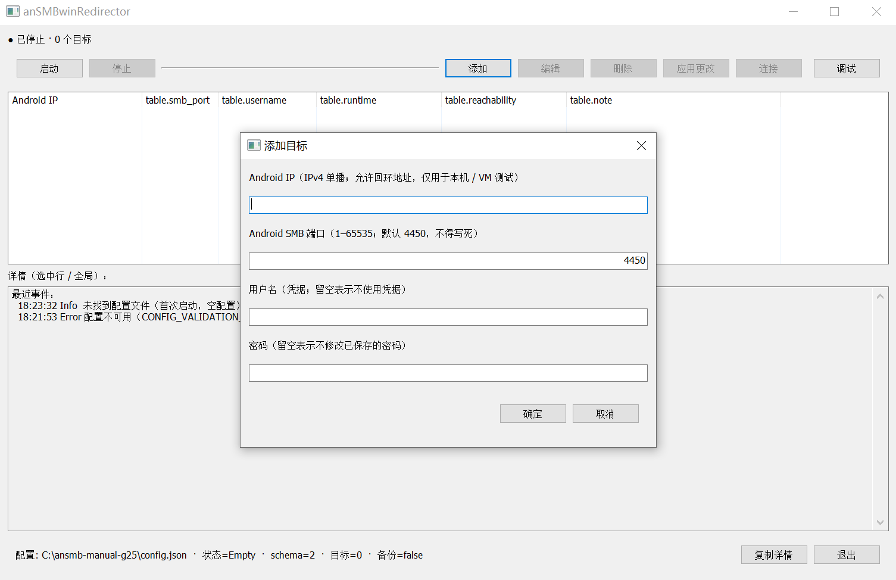
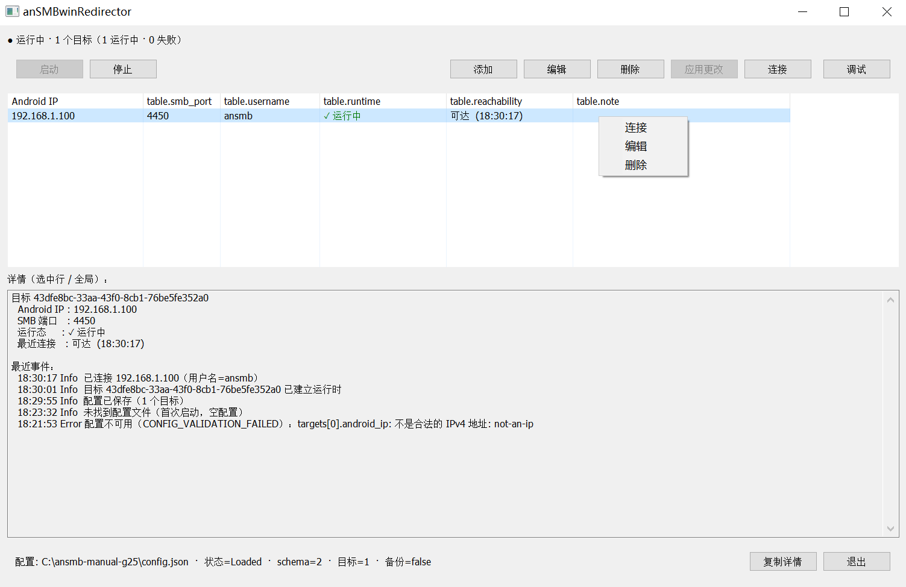

# anSMBwinRedirector

A small Windows utility that performs **transparent TCP destination-port rewriting**, so that the
native Windows SMB client / File Explorer can reach an `anSMBserver` instance running on Android
that listens on a **non-privileged port** (default `4450`, configurable).

```text
Windows Explorer / native SMB client
        │  TCP: <ephemeral port> → AndroidIP:445
        ▼
anSMBwinRedirector
        │  transparently rewrites the DESTINATION PORT: AndroidIP:445 → AndroidIP:<Android SMB port>
        ▼
Android anSMBserver (actually listening on that configurable port)
        │  TCP: AndroidIP:<port> → Windows ephemeral port
        ▼
anSMBwinRedirector
        │  transparently restores the SOURCE PORT: <port> → 445
        ▼
Windows Explorer / native SMB client
```

**Why this exists**: Android apps cannot bind privileged ports below 1024, so `anSMBserver` cannot
listen on `445`; the native Windows SMB client only talks to `445`, and UNC paths offer no way to
specify a port. (Note the direction of causation: `anSMBserver` using a non-standard port is a
consequence of an **Android platform limitation**, **not** a way to avoid clashing with
Windows' own `445`.)

**The whole behaviour, in one sentence** — for each target the program does exactly one thing:
rewrite the **destination port** `445` to the port you configured (the **destination IP is
unchanged**, the **Windows source port is untouched**), and restore the source port in the reverse
direction. It is **not** "a local 445 → 4450 port forward", it is **not** a generic `FROM → TO` NAT,
and tools such as `netsh interface portproxy` **cannot** replace it. It is neither an SMB server nor
an SMB client, and it does not handle UDP.

> Chinese documentation: [`README.zh-CN.md`](README.zh-CN.md) (source repository only).



*The **Add** dialog: Android IP, the Android SMB port (default `4450`), and optional credentials.*



*The target list: `Runtime` and `Last connect` are two independent columns (§5); right-click gives
**Connect / Edit / Delete**.*

> The screenshots live in the source repository under `assets/screenshots/`. The release package is
> fixed at 7 files and **contains no images**, so they will not render when this file is read from the
> package.

---

## 1. Requirements and installation

| Item | Requirement |
| --- | --- |
| OS | **Windows x64 (amd64)** — nothing else |
| Privileges | **Administrator** (needed to load the WinDivert driver) |
| Same-directory files | **`WinDivert.dll` and `WinDivert64.sys` must sit next to the exe**; both are required (see §6) |
| Directory | **The directory containing the exe must be writable** (the config, its backup and its temp file are written there — see §4) |
| Network | Must be able to reach the target Android device's IP |
| Android side | You must run `anSMBserver` on the device yourself and know which port it listens on; this project **does not include or provide** it |

> ⛔ **Windows on ARM64 is not supported**: an amd64 binary may run under emulation, but a kernel
> driver must be ARM64, so the bundled amd64 `WinDivert64.sys` cannot load. The program **refuses to
> start** with an explicit explanation before doing anything else.
> ⛔ 32-bit Windows is not supported (an amd64 executable will not start).

**Unzip and run — there is no installer.** Extract the release package into any **writable** directory:

```text
anSMBwinRedirector-<version>-win-x64/
├── anSMBwinRedirector.exe
├── WinDivert.dll            ← third-party (WinDivert 2.2.2-A); must sit next to the exe
├── WinDivert64.sys          ← third-party; must sit next to the exe
├── language.json            ← UI strings (`en` + `zh-CN`; UTF-8)
├── LICENSE                  ← full GPLv3 text for this project
├── THIRD_PARTY_NOTICES.md   ← third-party components and their full licenses
└── README.md                ← this file
```

- The release package contains **exactly these 7 files** and **no `config.json`** (that is runtime
  data, created when you first press "Apply Changes" — see §4).
- The Chinese documentation `README.zh-CN.md` lives **only in the source repository** and is **not**
  shipped in the release package (the package is fixed at the 7 files listed above).
- ⚠️ **Do not put it in a directory you cannot write to** (e.g. `C:\Program Files\...` with default
  permissions): the first save would fail, and the program treats "config directory not writable" as
  **Config Unavailable** (§4.3).
- The directory is **self-contained**: if you move or rename it, the configuration and the WinDivert
  files move with it (§4.1).

### 1.1 What it touches on your system

"Self-contained" applies to **files on disk**. The program does **not** write any file outside its
own directory, and it **never** writes `%PROGRAMDATA%`. But it is **not** side-effect-free: it uses
Windows system facilities, which is a different thing from "writing files somewhere else".

| Action | What it touches outside the program directory |
| --- | --- |
| **Connect** on a target that has a username/password | Creates/overwrites a **Windows credential** for that IP in the credential manager (`cmdkey`). It first asks before replacing an existing one |
| **Start** / **Stop** / **Exit** | Installs, stops or deletes the **`WinDivert` service** through the Service Control Manager (see §6.1). This is a system service registration, not a file in a directory |
| Debug → **Restart Workstation** | Stops and starts the **`LanmanWorkstation`** service (see §6.2) |
| **Connect** (opening the share) | Asks the **system default handler** (normally Explorer) to open `\\<Android IP>\` |

---

## 2. Quick start

1. Extract the release package into a **writable** directory.
2. Right-click `anSMBwinRedirector.exe` → **Run as administrator**.
3. Press **Add** and fill in the **Android IP** and the **Android SMB port** that `anSMBserver`
   actually listens on (default `4450`).
4. Press **Apply Changes**, then press **Start**.
5. Select the row and press **Connect** (or right-click the row → Connect).

**"Start" and "Connect" are two different things** — this trips people up:

| | What it does |
| --- | --- |
| **Start** | Starts the **redirection engine**, so the rules take effect for all targets |
| **Connect** | For **one selected target**: writes its Windows credentials (if configured), then asks Windows to open `\\<Android IP>\`. It is **not** an independent network probe, and it **requires that target to be already saved and running** — it will **not** start the redirection for you |

Then browse `\\<Android IP>\<share>` in File Explorer as usual. Windows still uses `445`, and the
program rewrites it to `<Android IP>:<your configured port>` behind the scenes.

The program does not modify the system proxy and does not use `netsh portproxy`.

---

## 3. First run (detailed)

The steps below describe a machine that **has no configuration file yet**.

1. Right-click `anSMBwinRedirector.exe` → **Run as administrator**.
2. The main window appears (along with a tray icon). **No configuration file is created yet** — the
   first start is an empty configuration; `config.json` appears in the **exe's directory** only when
   you first press "Apply Changes".
3. Press "Add" and fill in a target:
   - **Android IP**: the device's IPv4 address (e.g. `192.168.1.100`);
   - **Android SMB port**: the port `anSMBserver` actually listens on (default `4450`, configurable);
   - **username / password** (optional): if entered, they are written to the Windows credential store
     (`cmdkey`) before connecting. If left empty, existing system credentials are left untouched.
     *Username and password must either both be filled in or both be empty.*
   - *One Android IP can have only one rule.*
4. Press "Apply Changes" → `config.json` is created **next to the exe**. ⚠️ The **first** save does
   **not** create a `config.json.bak` — there is no previous version to keep (see §4.2).
5. Press "Start".
6. To open that server's shares: **select the row and press "Connect"** (or right-click the row →
   Connect). The target must have been saved ("Apply Changes") and must be running ("Start").

---

## 4. Configuration file

### 4.1 Location and format

```text
<directory containing anSMBwinRedirector.exe>\config.json
```

- Backup and temp files live in the **same directory**: `config.json.bak` and `config.json.tmp`.
- **The first start does not create the file**: it appears only on your first "Apply Changes".
- Saving works by "write a temp file first, then perform one file replacement": the program **never
  deletes the current valid `config.json` first** (⚠️ it does **not** promise disk-level atomicity
  against power loss or crashes).

```json
{
  "schema_version": 2,
  "targets": [
    {
      "id": "<stable UUID>",
      "android_ip": "192.168.1.100",
      "android_port": 4450,
      "username": "ansmb",
      "password": "……"
    }
  ]
}
```

- `id` is generated by the program and stays stable; **`android_ip` must be unique** within the rule
  set — duplicates are rejected.
- Each rule has four configurable fields: **Android IP**, **Android SMB port**, **username**,
  **password** (the last two may be empty; either both or neither). The matching Windows-side **TCP
  445** is fixed and not configurable.
- `targets` may be empty (meaning "no redirect target configured").

### 4.2 What happens to `config.json.bak`

| Save | Result |
| --- | --- |
| **First** save (no `config.json` yet) | Only `config.json` is created. ⛔ **No `.bak` is produced** — there is nothing to back up yet |
| **Second and later** saves | The **previous** `config.json` is preserved as `config.json.bak` before the new one replaces it |

So a `.bak` present means "you have saved at least twice, and this is the version from before your
last save". It is **not** a rolling history — there is only ever one `.bak`.

### 4.3 "Config Unavailable"

**Principle**: if the configuration **in the exe's directory** cannot be used, the program refuses to
pretend it has a configuration. This state is entered when:

- the file exists but **cannot be read**, or **cannot be parsed**, or **fails validation** (including
  duplicate IPs, illegal fields, or a `schema_version` written by a newer version); **or**
- the **config directory is not writable** (the startup write probe fails — see below).

In the **Config Unavailable** state the program:

```text
- loads no targets at all;
- creates no runtime and opens no WinDivert handle;
- disables "Start" (so it can never enter the running state);
- disables "Apply Changes" (to avoid overwriting a repairable file);
- never silently continues with an empty config, and never deletes or rewrites any file on its own;
- shows the file path plus the failure reason, and offers two explicit actions (below).
```

**Recovering from it — two explicit actions** (shown in the banner at the top of the window)

| Action | What it does |
| --- | --- |
| **Copy config path** | Puts the **path** of `config.json` on the clipboard. ⛔ It does **not** open the file or a folder — you then open that path **yourself** in a text editor to inspect or repair it |
| **Restart with empty config** | Starts over with an empty configuration **without deleting anything**: it **renames** the unusable `config.json` to `config.json.corrupt-<timestamp>` (content fully preserved) and continues with an empty config. Asks for confirmation first; cancelling changes nothing. When the file was written by a newer `schema_version`, the button is **still shown but disabled** (to prevent an accidental downgrade from destroying data). The rename itself still needs a writable directory |

**Write probe at startup**: on every start the program performs one **lightweight write probe** in the
config directory (= the exe's directory) — it creates a **dedicated, uniquely named** probe file
(filename prefix `.ansmbwinredirector-write-probe-`), writes a few bytes and **deletes it immediately**.

- The probe only cleans up **the file it created itself**; ⛔ it never uses user file names such as
  `config.json`, so it **cannot** leave an empty `config.json` behind.
- If the probe fails (or if **cleaning up** the probe file fails) ⇒ Config Unavailable, reporting the
  **directory path plus the underlying error**.
- ⚠️ Two different things: a successful probe **does not guarantee that saving will succeed** (the
  save checks every write/backup/replace step independently), and a probe file is **not** a
  configuration file — a successful probe never creates or modifies `config.json`.

**Common causes**

| Symptom | Action |
| --- | --- |
| `CONFIG_IO_ERROR` (directory not writable / insufficient permissions) | Make the program directory writable (or move it to a writable directory); e.g. **avoid** `C:\Program Files\` with default permissions |
| `CONFIG_IO_ERROR` (probe file cannot be cleaned up) | Check whether security software is locking the directory; this is also treated as "not writable" |
| `CONFIG_PARSE_ERROR` / `CONFIG_VALIDATION_FAILED` | Use "Copy config path" to get the path, then open that path **yourself** in a text editor and repair it by hand; the UI lists **all** violations |
| `CONFIG_SCHEMA_UNSUPPORTED` (file written by a newer version) | "Restart with empty config" stays **disabled** on purpose; use the newer version instead (to prevent accidental downgrade damage) |

---

## 5. Tray and main window

**Main window**

| Control | Description |
| --- | --- |
| Add / Edit / Delete | These only change the **draft**; "Edit" lets you set IP / port / username / password; a deleted row becomes "pending delete" and, while it is selected, the "Delete" button turns into "Undo delete" |
| **Apply Changes** | The **only** commit path: validate → write to disk (next to the exe, keeping a `.bak` from the second save on) → take effect. The status bar shows `⚠ Unsaved changes` while a draft differs |
| Start / Stop | Start/stop redirection for all targets ("Start" first performs the WinDivert takeover — see §6.1) |
| **Connect** | Opens that target's shares. **Requires the target to be saved and running** (⛔ it will not auto-"Start" — see §2). If Windows already has credentials for that IP, it **asks before replacing** them |
| Debug | see §6.2 |
| Copy details / Copy config path | Put the **diagnostics text** / the **path** of `config.json` on the clipboard (⛔ neither opens a window, a file or a folder) |
| Restart with empty config | Only shown in the "Config unavailable" banner — see §4.3 |
| Exit | If there are unsaved changes it asks "Save and apply / Discard / Cancel" |

**List interactions**: **single click = select** (does not open the editor); **double click = edit**;
**right click = context menu (Connect / Edit / Delete)**.
The "Last connect" column shows the result of the **most recent "Connect" action** (`Reachable(time)` /
`Not connected yet`); it is **not** an independent network probe.

**Tray**: left-click the icon to show the main window; the right-click menu offers the current status,
Start, Stop, Apply Changes (**only shown when there are unsaved changes**), "Open main window", and
Exit.
**Closing the main window only hides it to the tray**; it does not exit the program.

---

## 6. WinDivert: important behaviour, repair and cleanup

The redirect works by intercepting and rewriting packets at the network layer, which relies on the
third-party component **WinDivert 2.2.2-A**.

- It consists of **`WinDivert.dll` + `WinDivert64.sys`**, which **must be placed in the same directory
  as `anSMBwinRedirector.exe`**.
- At startup (and on every "Start") the program verifies the **SHA-256** of both files:
  - **missing** → `RUNTIME_FILE_MISSING` (with the full path);
  - **modified** → `RUNTIME_FILE_CORRUPT` (reporting both the **actual** and the **expected** SHA-256).
  - ⛔ In either case the program **only reports**: it never overwrites, never re-downloads and never
    deletes your files.
- On the first "Start", the WinDivert driver is **installed and loaded on demand** (this creates a
  Windows service and requires administrator rights). The install/load itself is done by WinDivert;
  **the "takeover" (stopping and deleting an existing service) is done by this program** — see §6.1.

### 6.1 This program owns the WinDivert service lifecycle (Start / Stop / Exit)

> ⚠️ **This can affect other software that uses WinDivert**
>
> "Start" **takes over the system service named `WinDivert`**: if one already exists (created by
> another tool), the program first **stops and deletes** it and then installs the driver from its own
> directory. **Any other software relying on that service may be affected.** The program **cannot
> enumerate** all WinDivert users on the system (see the end of §6.2), so it **cannot guarantee** that
> the takeover will not affect them. Close other tools that may be using WinDivert **before** starting.

**On "Start" (takeover)**: if a `WinDivert` service **already exists** (left behind by another tool,
or left over on the system), the program first **stops and deletes** it, waits until it is gone (`sc query`
returns **1060**), and only then lets WinDivert install `WinDivert64.sys` **from this program's own
directory**, verifying that the service's actual `ImagePath` points at this directory.

> ⛔ The program **never reuses** an existing WinDivert service — tests showed that doing so keeps
> loading a `.sys` from the **previous service path**. If the takeover fails it reports an explicit error
> (`WINDIVERT_TAKEOVER_FAILED`) and **never** falls back to the pre-existing service.

| Action | Effect on the WinDivert **service** | Effect on the `WinDivert.dll` / `WinDivert64.sys` **files** |
| --- | --- | --- |
| **Start** | if present ⇒ stop and **delete** it, then install from this program's directory | **not** modified (only reported when missing/modified) |
| **Stop** | stop and **delete** the service (`sc query` back to 1060), then wait until `.sys` is no longer locked | **not** deleted |
| **Exit** | measured: if it was running, after exit `sc query WinDivert` is **1060 (not installed)** | **not** deleted |
| **OS reboot** | ⛔ does **not** delete the service registration | ⛔ does **not** delete those two files |

> ⚠️ **Do not confuse "reboot" with "cleanup"**: a reboot only makes the **currently loaded driver
> instance** go away with the system shutdown (which is why it can resolve driver-version conflicts);
> it neither deletes the service registration nor the two files (they are just ordinary files you
> extracted).

⛔ The program offers **no** "force cleanup / bypass-the-takeover" uninstall entry point and **never
deletes** your `WinDivert.dll` / `WinDivert64.sys`. If you want to clean up a leftover registration
created elsewhere, do it yourself following WinDivert's official instructions (that is not a feature
of this program).

### 6.2 The "Debug" window

The "Debug" button opens a **diagnostics** window with three parts:

1. **Read-only diagnostics** (modifies nothing): the program directory; the paths, **file versions**
   and **actual / expected SHA-256** of `WinDivert.dll` / `WinDivert64.sys`; whether the WinDivert
   service exists, its current state, its `ImagePath` and whether it points at this program's
   directory; the **runtime driver version** (read-only diagnostics **do not open a driver handle**,
   so this item reads "not queried").
2. **`Repair / Reinstall WinDivert`**: removes an existing service registration through the **same
   takeover flow** as §6.1 and re-verifies the two runtime files in this program's directory.
   **It does not load the driver** (the driver is still loaded by the next "Start") and ⛔ does not
   modify any file. The button is disabled while the redirect is running (press "Stop" first).
3. **`Restart the Windows Workstation service`**: its purpose is to **clear the Windows SMB client
   session state**. ⛔ It is **not** a "network repair" and does **not** guarantee a fix (measured).
   It asks for confirmation first and interrupts existing SMB connections.

> ⚠️ Honest statement: WinDivert consumers on the `REFLECT` layer **cannot be enumerated**, so the
> program **cannot prove** that no other WinDivert consumer exists on the system.

---

## 7. Troubleshooting

| Symptom | Likely cause / action |
| --- | --- |
| `RUNTIME_FILE_MISSING` / `RUNTIME_FILE_CORRUPT` at startup | `WinDivert.dll` / `WinDivert64.sys` in the same directory are missing or modified: put the correct files back (the program **never** downloads or overwrites them) |
| "Cannot take over the system WinDivert service" (`WINDIVERT_TAKEOVER_FAILED`) | The service cannot be stopped/deleted (possibly in use by another program): retry later, or reboot and try again |
| The status bar shows "Config unavailable" | See §4.3: repair the config file or make the directory writable; until then the program will not start redirection and will not overwrite the file |
| "Connect" shows **no feedback for a long time** | When the target address is unreachable, Windows may take a long time to return from opening `\\<IP>\` (measured: >3 minutes). This is **system behaviour**, not a verdict from this program; the buttons stay disabled meanwhile |
| "Connect" is refused with "redirection is not running" | "Connect" does not start anything: press "Start" first (§2) |
| Explorer asks for a username/password | That target has no credentials configured; fill in username/password under "Edit", press "Apply Changes", then use "Connect" to store them in the Windows credential manager |
| Want to fully clean up WinDivert leftovers | See §6.1: the program offers no force-cleanup entry point; follow WinDivert's official instructions |

---

## 8. Known limitations and security notes (v1.0)

**Limitations**

- **Windows x64 only**; no 32-bit and no ARM64 support (ARM64 is explicitly rejected).
- **The exe's directory must be writable**: the configuration and its backup are written there (§4).
- ⛔ **No** "force cleanup / bypass-the-takeover" WinDivert uninstall entry point (§6.1).
- **No** installer, **no** auto-update, **no** code-signed package.
- Unknown fields in `config.json` are **rejected**, not ignored; a `schema_version` from a newer
  version makes the config unusable by design (§4.3).
- It is neither an SMB server nor an SMB client, not a generic port forwarder/proxy, and it does not
  support UDP.
- ⚠️ When the target address is **unreachable**, "Connect" may show **no result for a long time
  (measured: >3 minutes)** — this is how Windows behaves when opening `\\<IP>\`.
- ⛔ **No promise** of disk-level atomicity for config writes in extreme situations (power loss, crash) — §4.1.

**Security: passwords are stored in plaintext**

> ⚠️ **In v1.0 the password in `config.json` is stored in plaintext.**
> The program does **not claim** secure storage — it neither encrypts the file nor puts the
> configuration itself into the Windows credential manager. The file sits next to the exe and
> inherits that directory's access control; please secure the directory and the disk yourself.
> ⛔ The program offers **no** encrypted password storage in v1.0.

**Every file in the directory that can contain passwords**

| File | Contains plaintext passwords? |
| --- | --- |
| `config.json` | **Yes** |
| `config.json.bak` (from the second save on — §4.2) | **Yes** (it is a copy of a previous config) |
| `config.json.tmp` | Only transiently during a normal save; if a save is **interrupted abnormally** (power loss, crash, forced termination) it **may be left behind**. It contains plaintext passwords just like `config.json` |
| `config.json.corrupt-<timestamp>` (created by "Restart with empty config" — §4.3) | **Yes** (it is the previously used config, preserved unchanged) |
| `config.json.migrated-<timestamp>` (if present in the directory) | **Yes** (it is a copy of a config, including any plaintext passwords in it) |

⚠️ If the directory also contains `config.json*` files whose origin you cannot identify (for example
copies with a timestamp suffix), treat them as **credential material** as well.

⚠️ **Consequence**: when you **move, copy, share, back up or delete** the program directory, treat all
of these files as **credential material**, not as ordinary text. Deleting only `config.json` leaves
your password behind in the other files.

(The Windows credentials written by "Connect" are kept by the **system credential manager** and are
unrelated to these files. ⛔ Passwords **never** appear in logs, diagnostics details, the Debug window,
error messages or window titles.)

---

## 9. License, third-party components and acknowledgements

### 9.1 Project license

This project is licensed under **GNU GPLv3 — specifically `GPL-3.0-only`** (i.e. "GPLv3 only",
**without** "or any later version"). `LICENSE` is the verbatim GNU GPLv3 **full text** (unmodified,
including the "How to Apply" section at the end).

### 9.2 Third-party components shipped in the package

The component list, versions and **full license texts** are in `THIRD_PARTY_NOTICES.md`. In short:

- **WinDivert 2.2.2-A**: dual-licensed LGPLv3 / GPLv2; this project chooses **LGPLv3**, which is why
  its `WinDivert.dll` / `WinDivert64.sys` are distributed as **separate files** to keep them
  replaceable.
- Go dependencies (`lxn/walk`, `lxn/win`, `govaluate`, `golang.org/x/sys`, `imgk/divert-go`) are
  **compiled into the exe** and not shipped as separate files; their full license texts are also
  included in `THIRD_PARTY_NOTICES.md`.

### 9.3 Acknowledgements and reference projects

This project benefited from the following open-source projects. Many thanks to their authors and
contributors.

- [**WinDivert**](https://github.com/basil00/Divert): provides Windows packet filtering and handling,
  which this project uses to implement transparent TCP destination-port rewriting. Version,
  distributed files and license information: see §9.2.
- [**detour**](https://github.com/LeeJeKyun/detour): a **design reference** for this project — a
  Go-based Windows network redirection tool whose program structure and GUI informed this
  implementation. **No source code from it is reused** (see `THIRD_PARTY_NOTICES.md` §1.3); this
  project is an independent implementation targeting the `anSMBserver` use case.

---

## 10. Building from source

Requires **Go 1.27.1** (see `src/go.mod`) on any platform that can cross-compile to Windows.

```sh
scripts/build-release.sh 1.0          # output under dist/release/
```

Key points:

- The package contains **exactly 7 files** (§1); `dist/` is ignored by `.gitignore`.
- **The manifest is mandatory**: the GUI toolkit `lxn/walk` needs a Common-Controls v6 manifest;
  without it the window **cannot be created at all**. The manifest is **embedded** as a `.syso`
  resource (`cmd/ansmbwinredirector/rsrc_amd64.syso`), which `go tool rsrc` (version pinned via the
  `tool` directive in `go.mod`) can regenerate **reproducibly**; the release script regenerates it and
  compares it **byte-for-byte**, failing on any difference.
- **The WinDivert SHA-256 values are frozen as compile-time constants**
  (`src/internal/winvert/assets_common.go`). When upgrading WinDivert you must update those constants
  too — `go test ./internal/winvert` enforces this.
- ⚠️ The executable is **not** byte-for-byte reproducible across builds: the script injects the
  **build time** into the exe's version information, so each build has a different hash (the other six
  files are byte-for-byte copies of repository content). To check which commit an exe came from, read
  its **embedded `vcs.revision` / `vcs.modified` and version strings**.
